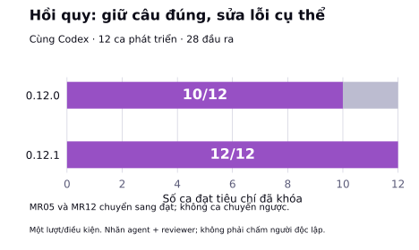
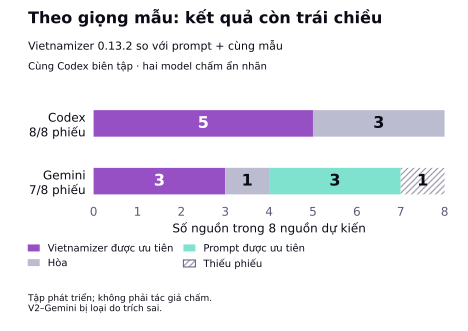

# Vietnamizer


> **Biên tập tiếng Việt rõ ý, giữ nghĩa và giọng người viết.**

Vietnamizer là skill giúp Claude, Codex và các agent tương thích rà bản nháp AI,
bản dịch sát và văn bản tiếng Việt đọc chưa thuận. Skill chọn quy tắc theo thể loại,
chỉ sửa khi có căn cứ và kiểm lại nghĩa trước khi giữ thay đổi.

**Không cần API key cho core Markdown.** Mặc định giữ giọng gốc; khi được yêu cầu rõ,
có thể điều chỉnh theo mẫu người dùng cung cấp. Khả năng theo giọng mẫu vẫn đang được hiệu chỉnh.

[Cài nhanh](#cài-nhanh) · [Xem bằng chứng](#bằng-chứng-và-kiểm-thử) · [Dùng ngay](#dùng-ngay) · [Tài liệu](#tài-liệu-chi-tiết)

## Vietnamizer hữu ích ở đâu?

| Khi cần | Skill hướng agent làm gì? |
|---|---|
| Rà bản nháp AI hoặc bản dịch sát | Tìm lỗi cụ thể về từ, bổ ngữ và cấu trúc câu |
| Biên tập blog, bài chuyên môn | Giữ ý định, mức khẳng định, câu rút gọn và nhịp dấu câu |
| Rà README, báo cáo, tài liệu công việc | Giữ thuật ngữ và giọng theo thể loại |
| Biên tập theo giọng mẫu | Dùng đặc tính có bằng chứng, kiểm riêng việc thêm/bỏ hoặc đổi ý |

Dùng như một bước biên tập có kiểm soát trước khi gửi hoặc xuất bản. Đọc lại những chỗ
đổi xưng hô, cấu trúc và dấu câu; skill không xác minh sự thật trong bài.

## Trước/sau: sửa chỗ cần sửa, giữ chỗ đã đúng

Trích đầu ra thật trên cùng Codex trong lượt hồi quy **0.12.0/0.12.1** ngày 27/10/2026.
Bảng chỉ hiển thị phần liên quan; kết quả này không phải phép đo mới cho 0.13.2.

| Ca | Bản gốc | Sau biên tập với 0.12.1 |
|---|---|---|
| MR04 · thiếu bổ ngữ | Đã tìm khắp nhà nhưng vẫn không tìm chìa khóa. | Đã tìm khắp nhà nhưng vẫn không tìm **thấy** chìa khóa. |
| MR05 · điểm ngắt có chức năng | Tất cả – chỉ khác là… | Giữ nguyên điểm ngắt; 0.12.0 đã đổi thành dấu phẩy. |
| MR12 · đối tượng đã rõ | Tôi đang soạn hướng dẫn bàn giao. Soạn xong rồi dừng. | Giữ nguyên; 0.12.0 đã thêm “bản hướng dẫn” vào câu sau. |

Ở MR04, ngữ cảnh là đã tìm nhưng chưa thấy. MR05 không có quy chuẩn buộc đổi dấu;
MR12 đã rõ đối tượng từ câu trước. [Xem đủ ca và tiêu chí](specs/018-mr-version-comparison/results.md).

## Bằng chứng và kiểm thử

**Có bằng chứng hồi quy về sửa lỗi và tránh sửa quá tay; chưa có chấm người độc lập.**
Các phép so sánh dưới đây dùng cùng agent biên tập, không xếp hạng Codex với Gemini.

### Hồi quy: hai ca sửa quá tay đã được khắc phục trong lượt đối chiếu

<picture>
  <source media="(max-width: 600px)" srcset="docs/figures/regression-cases-mobile.svg">
  
</picture>

**12 ca, 14 tình huống × 2 phiên bản = 28 đầu ra.** MR05 và MR12 chuyển từ chưa đạt sang đạt;
không ca nào chuyển ngược trong lượt này. Đây là tập phát triển đã dùng để sửa skill,
mỗi điều kiện sinh một lần; nhãn do agent đối chiếu và reviewer kiểm tra.
**12/12 không có nghĩa 100% văn bản sẽ được sửa đúng.**
[Xem báo cáo hồi quy](specs/018-mr-version-comparison/results.md).

### Theo giọng mẫu: có tín hiệu tốt, kết quả còn trái chiều

<picture>
  <source media="(max-width: 600px)" srcset="docs/figures/reference-voice-mobile.svg">
  
</picture>

Cả hai hàng là **model chấm ẩn nhãn**, cùng đánh giá đầu ra do **Codex biên tập**.
So sánh dùng cùng bản gốc, mẫu giọng và yêu cầu theo mẫu. Mỗi hàng có tám nguồn dự kiến;
phiếu V2–Gemini bị loại do trích dẫn sai và giữ ở trạng thái thiếu.

Hai giám khảo đồng ý lựa chọn ở **4/7 nguồn cùng có phiếu**. Corpus đã được dùng để
hiệu chỉnh skill; model chấm không thay thế tác giả hoặc người đọc. Chưa đủ bằng chứng
Vietnamizer luôn tốt hơn prompt thông thường kèm mẫu.
[Xem pilot 0.13.2](specs/025-section-voice-pilot/results.md) · [Phương pháp, dữ liệu và mọi đợt đánh giá](docs/benchmarks.md).

**Kết luận thực dụng:** đáng thử khi cần một quy trình rà tiếng Việt có quy tắc rõ và
kiểm soát sửa quá tay. Với yêu cầu theo giọng mẫu, cần đọc lại từng bản sửa.
Không dùng mức đổi ký tự, độ dài hay token làm điểm chất lượng.

## Cài nhanh

Bản hiện tại là **0.13.2**. [Tải các gói từ GitHub Release](https://github.com/fioenix/vietnamizer/releases/latest).

### Skills CLI

```bash
npx skills add fioenix/vietnamizer --skill vietnamizer
```

### Codex plugin — catalog Finolabs

Với cài đặt mới chưa có marketplace `agybird` cũ:

```bash
codex plugin marketplace add fioenix/agybird
codex plugin add vietnamizer@Finolabs
```

Đã đăng ký marketplace `agybird`? Đọc [hướng dẫn chuyển và khôi phục](docs/installation.md)
trước khi đổi đăng ký. **Finolabs** là catalog dùng chung; không phải chứng nhận từ OpenAI.

### Claude Code plugin

```text
/plugin marketplace add fioenix/vietnamizer
/plugin install vietnamizer@vietnamizer
```

Mở session mới sau khi cài. [Claude web/Desktop, Claude Org, cài thủ công và đóng gói](docs/installation.md).

## Dùng ngay

Gọi `Vietnamizer` và giao bản nháp, thể loại, người đọc cùng phần cần bảo toàn. Ví dụ:

```text
Use Vietnamizer to copyedit the Vietnamese draft below for a personal blog.
Preserve its meaning, level of certainty, terminology and existing voice.
Keep quotations and code unchanged. Return only the edited article.

<draft>Paste your draft here.</draft>
```

Có thể yêu cầu bảng trước/sau và lý do thay đổi. [Prompt theo tình huống và cách trả kết quả](docs/usage.md).

## Giữ giọng khi có mẫu

Chỉ gửi mẫu chưa tự bật chuyển giọng. Để điều chỉnh theo mẫu, yêu cầu rõ việc đó và
cung cấp mẫu/hồ sơ ngay trong tác vụ. Skill có thể đổi cách diễn đạt hoặc cấu trúc từ
các ý đã có, vẫn phải giữ mệnh đề, điều kiện, mức chắc chắn và vùng bảo toàn.

Skill không tự tìm/lưu hồ sơ cá nhân hoặc tạo trải nghiệm thay người viết.
[Xem hai chế độ, ví dụ prompt và bảy style card](docs/style-and-voice.md).

## Phạm vi

- Tự chọn profile theo thể loại; công văn, hợp đồng, thơ và changelog chỉ rà typography.
- Bảo toàn dữ kiện, thuật ngữ, code và trích dẫn nguyên văn; không suy tác giả AI từ lỗi ngôn ngữ.
- Khi host cấp key và quyền gửi, runner tự động thử tư vấn Jev; thiếu key hoặc lỗi dịch vụ vẫn dùng core.
- Chỉ cung cấp văn bản được phép chia sẻ, không chứa credential hoặc dữ liệu bị hạn chế.

[Xem xử lý dữ liệu và Jev](docs/usage.md) · [Quyền riêng tư](PRIVACY.md) · [Báo lỗi bảo mật](SECURITY.md).

## Danh mục pattern

| Nhóm | Số lượng | Phạm vi |
|---|---:|---|
| V1–V25 | 25 | Cách dùng từ và cấu trúc câu |
| T1–T6 | 6 | Typography |
| B1–B17 | 17 | Blog, bài cá nhân, nội dung công việc và marketing |
| K1–K7 | 7 | Tài liệu kỹ thuật, doanh nghiệp và học thuật |

**55 pattern.** [Danh mục đầy đủ](docs/patterns.md); quy tắc chuẩn nằm trong `SKILL.md` và `profiles/`.

## Tài liệu chi tiết

| Cần tìm | Tài liệu |
|---|---|
| Cài đặt theo nền tảng, marketplace và đóng gói | [Cài đặt](docs/installation.md) |
| Prompt, phạm vi, dữ liệu và tư vấn Jev | [Sử dụng](docs/usage.md) |
| Giữ giọng gốc, theo mẫu và chọn phong cách | [Giọng và phong cách](docs/style-and-voice.md) |
| Cây nguồn, các tầng quy tắc và thành phần | [Kiến trúc](docs/architecture.md) |
| Tên và vai trò của từng pattern | [Danh mục 55 pattern](docs/patterns.md) |
| Phương pháp, giới hạn và các kết quả benchmark | [Benchmark](docs/benchmarks.md) |
| Tài liệu tham khảo và mức độ tin cậy | [Nguồn và ghi nhận](docs/sources.md) |
| Thay đổi qua từng phiên bản | [Changelog](docs/changelog.md) |

## Lịch sử phiên bản

- **0.13.2** (28/10/2026) — Ưu tiên giữ nghĩa, chọn nét giọng theo chức năng từng phần; không mặc định cấm câu hỏi hay “bạn”. [Lịch sử đầy đủ](docs/changelog.md).

## Đóng góp

[Gửi ca sửa sai hoặc góp mã](CONTRIBUTING.md) · [Issues](https://github.com/fioenix/vietnamizer/issues) · [Điều khoản](TERMS.md).

## Giấy phép

Fioenix / FINOLABS · [Giấy phép MIT](LICENSE).
