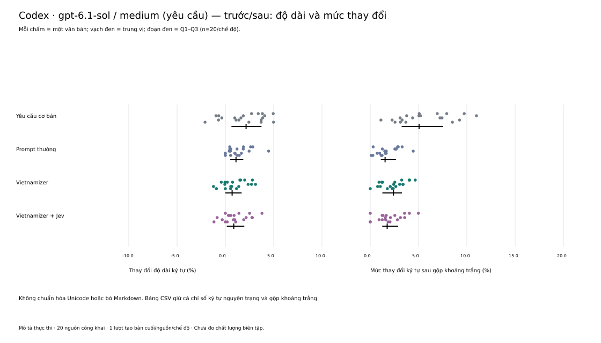
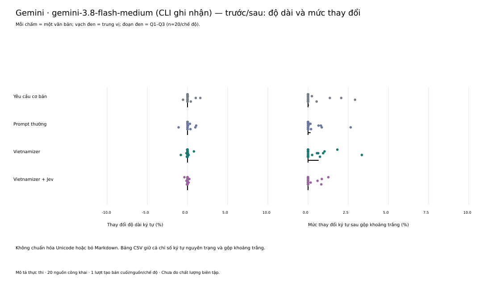
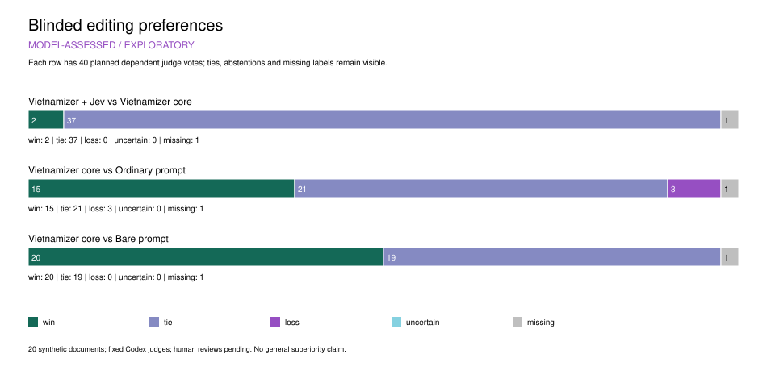

# Benchmark: phương pháp, kết quả và giới hạn

[← README](../README.md)

## Trước/sau: sửa chỗ cần sửa, giữ chỗ đã đúng

Ba ví dụ dưới đây là **đầu ra thật trong lượt hồi quy trên cùng Codex** ngày
27/10/2026. Cả hai phiên bản nhận cùng nguồn, ngữ cảnh và yêu cầu; các ô có dấu
`…` chỉ trích phần liên quan, không phải toàn bộ văn bản.

| Ca và mục tiêu | Bản gốc | Sau biên tập với 0.12.0 | Sau biên tập với 0.12.1 |
|---|---|---|---|
| MR04 · sửa thiếu bổ ngữ kết quả | Đã tìm khắp nhà nhưng vẫn không tìm chìa khóa. | Đã tìm khắp nhà nhưng vẫn không tìm **thấy** chìa khóa. | Đã tìm khắp nhà nhưng vẫn không tìm **thấy** chìa khóa. |
| MR05 · giữ điểm ngắt | Tất cả – chỉ khác là… | Tất cả, chỉ khác là… | Tất cả – chỉ khác là… |
| MR12 · giữ câu rút gọn đã rõ nghĩa | Tôi đang soạn hướng dẫn bàn giao. Soạn xong rồi dừng. | Tôi đang soạn hướng dẫn bàn giao. Soạn xong **bản hướng dẫn** rồi dừng. | Tôi đang soạn hướng dẫn bàn giao. Soạn xong rồi dừng. |

MR04 có ngữ cảnh đã tìm mà chưa thấy, không phải từ chối tìm. MR05 không có
quy chuẩn buộc đổi dấu; MR12 đã rõ đối tượng từ câu trước. Giữ nguyên ở hai ca
sau là hành vi mong đợi, không phải bằng chứng skill bỏ qua mọi câu ngắn.
[Báo cáo từng ca](../specs/018-mr-version-comparison/results.md) ghi tiêu chí, raw
đã lưu, các trường hợp không tái hiện lỗi và giới hạn của phép so sánh.

## Bằng chứng và kiểm thử

**Có dữ liệu thực thi, ví dụ đối chiếu và kết quả hồi quy; chưa có chấm người độc lập.**
Các phép so sánh thực hiện trên cùng agent/model, không dùng để xếp hạng Codex với Gemini.

| Đợt đánh giá | Số liệu cụ thể | Kết luận được hỗ trợ |
|---|---|---|
| [Hồi quy 0.12.0 → 0.12.1](../specs/018-mr-version-comparison/results.md) | 12 ca, 14 tình huống × 2 phiên bản = **28 đầu ra**; đạt **10/12 → 12/12 ca** | MR05 và MR12 chuyển từ chưa đạt sang đạt theo tiêu chí khóa trước; mỗi điều kiện chỉ sinh một lần, nhãn do agent đối chiếu và reviewer kiểm tra |
| [Pilot giữ giọng Mindfio, 0.12.0](../specs/016-sample-voice-preservation/mindfio-results.md) | **4 bài × 3 chế độ = 12 đầu ra**, cùng Codex | Workflow có hồ sơ đã chạy được; lợi ích giữ giọng chưa đồng đều và chưa tách riêng được tác động của hồ sơ với hướng dẫn đọc mẫu |
| [Nguồn AI công khai, 0.11.0](../specs/014-editorial-benchmark/execution-report.md) | **20 nguồn × 4 chế độ = 80 đầu ra** trong mỗi bộ Codex/Gemini; tổng **160 đầu ra** | Đo được thay đổi văn bản, thời gian và token; chưa suy thành điểm chất lượng hoặc tỷ lệ thắng |

MR01–MR12 là tập phát triển đã dùng để cải tiến skill, không phải tập đánh giá
độc lập. **12/12 không có nghĩa 100% văn bản sẽ được sửa đúng**; nhãn chỉ xét
tiêu chí của từng ca. Ở nhánh nhận xét MR11, 0.12.1 vẫn tự dùng “mày” khi ngữ
cảnh không xác lập quan hệ xưng hô; vấn đề này được ghi riêng trong báo cáo.

Số liệu thực thi và điểm chất lượng được tách riêng. Có thay đổi trong bản sửa chưa chứng
minh thay đổi đó tốt hơn; các ca giữ nguyên cũng được giữ trong bộ đánh giá.

| Bằng chứng hiện có | Có thể kiểm tra điều gì? | Giới hạn |
|---|---|---|
| [Test tự động](../tests/) | Hành vi runner: phân đoạn, vùng bảo toàn, coverage, xử lý phản hồi và lỗi dịch vụ | Test dùng phản hồi giả lập không đo chất lượng phán đoán của Jev hay bản biên tập cuối |
| [Ca kiểm thử chạy tay](../calibration/ca-kiem-thu.md) | Kết quả mong đợi của từng tình huống, gồm cả ca không được sửa | Có ca kiểm thử chưa đồng nghĩa đã chạy và đạt |
| [Nhật ký hiệu chuẩn](../calibration/LOG.md) | Bằng chứng và quyết định đằng sau các lần sửa quy tắc | Ca đã dùng để chỉnh quy tắc không phải tập đánh giá độc lập |

Có thể chạy nhóm test về runner, vùng bảo toàn và lỗi dịch vụ mà không cần gọi API:

```bash
python3 -B -m unittest tests.test_jev tests.test_context_protection tests.test_coverage_faults
```

<details>
<summary>Chi tiết bộ 160 đầu ra công khai và biểu đồ trước/sau — quy tắc 0.11.0</summary>

### Trước và sau khi dùng Vietnamizer trên cùng agent — cập nhật 26/10/2026

Bộ số liệu dưới đây dùng quy tắc **0.11.0**. Từ lúc dùng các ca này để hiệu chuẩn bản 0.11.1, cả 20 nguồn trở thành **tập phát triển/hồi quy** cho những phiên bản sửa theo chúng; không dùng lại như holdout độc lập để chứng minh chất lượng bản mới. Xem [hồ sơ hiệu chuẩn](../specs/015-benchmark-calibration/results.md).

20 câu trả lời nguyên văn từ [TTP01/Vietverse-SFT-Preview](https://huggingface.co/datasets/TTP01/Vietverse-SFT-Preview/tree/6b4e4a86e3b399318ac4fe91b2bbe64501037f40), có nhãn `synthetic_llm` và dấu vết xử lý do bên phát hành công bố, giấy phép Apache 2.0. Đã lưu nguyên bản 100 dòng, câu hỏi gốc, metadata, revision và SHA-256; chốt 20 mẫu trước khi biên tập. Chưa có raw API hoặc tên model tạo nguồn được đối soát.

Câu hỏi chính: **cùng một văn bản, sau khi dùng Vietnamizer có tự nhiên, rõ ràng hơn mà vẫn giữ đúng ý, số liệu và giọng không?** “Trước” là bản AI gốc đã đóng băng; “sau” là bản agent biên tập từ chính bản đó. Nhánh yêu cầu cơ bản cũng là bản sau biên tập, không thay thế bản gốc.

Báo kết quả trước/sau riêng cho từng chế độ trên cùng agent. Các nhánh yêu cầu cơ bản và prompt thường giúp kiểm tra thêm phần đóng góp của Vietnamizer; nhánh có Jev giúp kiểm tra phần đóng góp của tư vấn. Codex và Gemini là hai lần thực hiện riêng của cùng thiết kế, không dùng để xếp hạng agent và không gộp nhãn thành một mẫu.

Cả bốn nhánh yêu cầu cùng cấu hình Codex `gpt-6.1-sol`, effort `medium`, **mỗi nhánh một lượt tạo bản cuối từ cùng bản gốc**. Backend thực chưa có attestation; 80 lượt đều hoàn tất, không ghi nhận tool.

| Chế độ | Bản hoàn tất | Trùng hoàn toàn bản gốc |
|---|---:|---:|
| Yêu cầu biên tập cơ bản | 20/20 | 0 |
| Prompt biên tập thông thường | 20/20 | 0 |
| Vietnamizer | 20/20 | 1 |
| Vietnamizer + Jev | 20/20 | 2 |

“Trùng hoàn toàn” tính cả khoảng trắng và định dạng, **không phải điểm chất lượng**. Jev hoàn tất phạm vi theo hợp đồng ở 1/20 nguồn; 19 nguồn có tư vấn thiếu do giới hạn, ngữ cảnh/phân đoạn hoặc lỗi phản hồi. Các ca này vẫn nằm trong bộ chấm. Chi phí Jev theo usage cộng dự phòng là **0,4564 USD / trần 2 USD**, gồm 0,2003 USD của đợt trước; chưa đối soát hóa đơn.

**[Báo cáo benchmark thực thi đầy đủ](../specs/014-editorial-benchmark/execution-report.md)** có 7 hình phân tích, bảng từng nguồn, trung vị và Q1–Q3, cùng phương pháp tái lập từ raw. Hình mô tả thay đổi và tài nguyên; không phải điểm chất lượng hoặc bằng chứng Vietnamizer thắng đối chứng.

#### Trong bộ Codex

Mức thay đổi ký tự trung vị so với bản gốc là **2,42%** với Vietnamizer và **1,75%** với Vietnamizer + Jev. Đây là `1 − SequenceMatcher.ratio`, có tính khoảng trắng/Markdown; không phải tỷ lệ lỗi hay tỷ lệ nội dung được cải thiện.



#### Trong bộ Gemini

Đã đối soát **80/80 bản**, cùng bốn chế độ và 20 nguồn; raw CLI ghi nhận `gemini-3.8-flash-medium`. Mỗi chế độ lần lượt có **15, 12, 12, 15 bản giữ nguyên hoàn toàn** (yêu cầu cơ bản, prompt thường, Vietnamizer, Vietnamizer + Jev). Các trường hợp giữ nguyên vẫn được giữ trong phân tích; chưa đánh giá chúng đúng hay bỏ sót lỗi.



Báo cáo tách riêng hai runtime và không dùng các số này để xếp hạng agent. Tổng cộng có 160 đầu ra nhưng chỉ 20 nguồn; mỗi nguồn/chế độ/runtime có một lượt tạo bản cuối. Nguồn từ một tập SFT đã tuyển chọn, chưa phải holdout đại diện cho mọi văn bản AI. Token/thời gian lấy từ CLI; chi phí thuê bao chưa quy thành USD.

Hai Forms và [công cụ chấm người](../specs/014-editorial-benchmark/human-analysis-runbook.md) giữ nguyên để dùng lại khi cần, không phải bước phải chờ để hoàn thành báo cáo mô tả. Không gọi thêm model/Jev, không dùng nhãn khảo sát hoặc điểm model từ pilot cũ cho báo cáo hiện tại. Xem [trạng thái](../specs/014-editorial-benchmark/CURRENT.md), [nguồn và thực thi](../specs/014-editorial-benchmark/public-ai-results.md), [phương pháp trước/sau](../specs/014-editorial-benchmark/within-agent-amendment.md).

</details>

<details>
<summary>Pilot trước trên văn bản giả lập — thiết kế và dữ liệu riêng</summary>

[Đặc tả benchmark](../specs/014-editorial-benchmark/spec.md) xác định phép so sánh cùng một
model ở bốn chế độ: không dùng skill, dùng prompt biên tập thông thường, dùng Vietnamizer
và dùng Vietnamizer kết hợp Jev. [Chế độ có Jev](../specs/014-editorial-benchmark/jev-extension.md)
đã được triển khai và chạy pilot trên Codex; tình trạng nhận tư vấn và fallback được báo riêng.
Benchmark cần đo sửa đúng, sửa quá tay, giữ nghĩa và giữ giọng, kèm thời gian và chi phí.
Điểm model thăm dò được báo riêng bên dưới; chưa có kết luận thắng đối chứng đã được người đọc xác nhận.

**Pilot ngày 25/10/2026:** đã thu 60 bản biên tập từ Codex và 10 bản từ Gemini 3.8 Flash trên
văn bản giả lập; một trial Gemini bị cách ly vì gọi tool ngoài yêu cầu. Việc chạy tiếp bị chặn
khi chưa xác minh được cách ly dữ liệu. Pilot chưa đạt mục tiêu 120 đầu ra và chưa được chấm
chất lượng độc lập. Xem [kết quả, phạm vi kiểm chứng và phần còn thiếu](../specs/014-editorial-benchmark/pilot-results.md).

**Codex + Jev, cập nhật ngày 25/10/2026:** đã nhận đủ phản hồi Jev cho **20/20 văn bản**
và tạo **20 bản Codex + Jev mới**. Bộ chấm hiện tại có 80 bản cuối cho bốn chế độ, dùng lại
các bản đối chứng từ đợt trước. Các câu trả lời “chưa đủ ngữ cảnh” vẫn được giữ nguyên;
nhận đủ phản hồi không đồng nghĩa biên tập đã đúng. Tổng chi phí Jev từ usage cộng dự phòng
khoảng **0.2003 USD / 2 USD**, chưa phải hóa đơn đối soát. Raw request/response, lỗi,
nguồn từng câu trả lời và bảng phân tích được lưu local. Chưa có chấm chất lượng độc lập
hoặc bằng chứng hiệu quả Jev. Xem [báo cáo phục hồi và giới hạn](../specs/014-editorial-benchmark/recovery-results.md),
[lưu trữ dữ liệu](../specs/014-editorial-benchmark/data-archive.md) và
[báo cáo đợt partial/fallback trước](../specs/014-editorial-benchmark/codex-jev-results.md).


**Chấm bằng model, ngày 25/10/2026 — MODEL-ASSESSED / EXPLORATORY:** hai cấu hình giám khảo
Codex (yêu cầu GPT-6.1 Sol và GPT-6 Astra; backend chưa được attestation) chấm 80 bản cuối.
Có **156/160 nhận xét hợp lệ**; bốn nhận xét thiếu do một nhóm lỗi enum, không gọi lại.
Vietnamizer + Jev so với Vietnamizer tự rà: **2 phiếu thắng, 37 hòa, 0 thua, 1 thiếu**.
CI 95% của preference còn chạm mức trung tính; chưa có bằng chứng rõ về lợi ích tăng thêm
của Jev. Hai baseline cũ ít lượt sửa hơn nên các so sánh với chúng có giới hạn thiết kế.



Đơn vị thống kê là 20 nguồn giả lập; CI ghép cặp dùng 19 nguồn đủ cả hai giám khảo, không
coi các nhận xét là mẫu độc lập. Hai model cùng nhà cung cấp; điểm model không phải nhãn
chuẩn. Xem [kết quả, CI, an toàn và dữ liệu](../specs/014-editorial-benchmark/quality-results.md),
[protocol](../specs/014-editorial-benchmark/quality-protocol.md) và
[bộ giao hai người chấm](../specs/014-editorial-benchmark/human-handoff.md).
Bộ người đọc dùng [cách chấm trực tiếp](../specs/014-editorial-benchmark/human-simple-protocol.md):
xem bản gốc cạnh bản sửa, trả lời ba câu cho mỗi đoạn; vẫn ẩn tên bốn chế độ.
Nhãn giữ đúng và độ dễ đọc được báo riêng, không suy thành precision/recall của từng lần sửa.

</details>

[Pilot tách mẫu và skill trên cùng Codex, nguồn0.12.1](../specs/019-voice-factorial-benchmark/results.md)
có32đầu ra và15/16phiếu model hợp lệ. Trên bốn nháp AI trung tính, cả hai giám khảo đều chọn
prompt+mẫu hơn Vietnamizer+cùng mẫu. Đây là dữ liệu phát triển dẫn tới hai chế độ của0.13.0,
không phải bằng chứng bản mới đã tốt hơn. Giám khảo có thiên lệch về hình thức; chưa có chấm
người hoặc tác giả xác nhận.

[Pilot so0.13.0với0.12.1](../specs/021-voice-version-pilot/results.md) đã có **32 đầu ra** trên cùng
Codex. So0.13.0với prompt+cùng mẫu, Codex chọn thắng/hòa/thua **1/1/6**, Gemini **2/0/6** trên
tám bản. V1 còn thêm chú giải số nhiều ngoài nguồn. Đây là dữ liệu phát triển, chưa chứng minh
skill vượt prompt+mẫu. Bản0.13.1 sửa chỉ dẫn và ví dụ từ các lỗi đó.

[Pilot023cho0.13.1](../specs/023-voice-patch-pilot/results.md) có32đầu ra trên cùng Codex. So với
prompt+cùng mẫu, Codex chọn thắng/hòa/thua4/2/2,Gemini5/0/3; hai giám khảo chỉ đồng ý lựa chọn
ở3/8bản. Riêng N2cả hai thích0.13.0hơn, dù đều ghi nghĩa được giữ. Đây là tập phát triển đã dùng
sửa skill, không chứng minh vượt trội. Bản0.13.2 làm rõ chọn nét giọng theo chức năng từ ca này;
Kiểm offline/package không xác nhận hiệu quả biên tập.

[Pilot025cho0.13.2](../specs/025-section-voice-pilot/results.md) có32đầu ra và15/16phiếu chấm hợp lệ;
V2–Gemini thiếu do quote sai, không hỏi lại. N2:Codex cho0.13.1/0.13.2hòa4→4,Gemini nâng4→5;
cả hai ghi nghĩa được giữ và chọn0.13.2hơn prompt+cùng mẫu. Toàn bộ so phiên bản,Codex0/6/2
thắng/hòa/thua trên8bản,Gemini4/0/3trên7bản có phiếu. N2có tín hiệu tích cực, chưa chứng minh
nâng cấp đồng đều. Đây vẫn là tập phát triển và model chấm, không phải xác nhận từ tác giả/người đọc.

[Pilot Mindfio ngày 27/10/2026](../specs/016-sample-voice-preservation/mindfio-results.md)
đã có **12/12 bản cuối** trên cùng Codex: bốn bài, ba chế độ, hồ sơ được chủ nhân
duyệt và nguồn 0.12.0 đóng băng trước khi chạy. Có raw CLI, đối chiếu trước/sau và
hai hình phân tích thay đổi/tài nguyên. Nhận xét chất lượng là thăm dò của agent;
chưa chứng minh thêm hồ sơ giúp giữ giọng tốt hơn trên mọi bài. Bộ này giữ riêng,
không thay kết quả benchmark 0.11.0 hoặc hai Forms cũ.

Ví dụ ở M05: nhánh core thêm `với sự trống rỗng ấy` vào câu `Mà chạy để tránh
đối diện.`, còn nhánh kèm hồ sơ giữ câu ngắn. Tuy nhiên prompt thường kèm hồ sơ
cũng giữ câu này. Đây là ví dụ hữu ích để đọc và chọn bản sửa, **chưa chứng minh
lợi ích riêng của Vietnamizer hoặc tỷ lệ khớp giọng**. Cả bốn bài đã qua biên tập
AI theo xác nhận của chủ nhân; không có bản nháp trước AI để đối chiếu.

[Hiệu chỉnh 0.12.1 từ Mindfio](../specs/017-preserve-meaning-rhythm/results.md) ưu tiên
giữ ý muốn/khả năng/phạm vi, câu rút gọn có chức năng và quan hệ ý khi đổi dấu.
Đã [chạy đối chiếu MR01–MR12 trên cùng Codex](../specs/018-mr-version-comparison/results.md):
0.12.0 đạt 10/12 ca và 0.12.1 đạt 12/12 theo tiêu chí đã khóa, với MR05/MR12 chuyển
từ chưa đạt sang đạt. Mỗi tình huống chỉ sinh một bản cho mỗi phiên bản; nhãn do
agent đối chiếu và reviewer kiểm tra, không phải chấm người độc lập. Những bài đã dùng để hiệu chỉnh là dữ liệu phát triển/hồi quy,
không còn là holdout độc lập để chứng minh bản mới tốt hơn.
