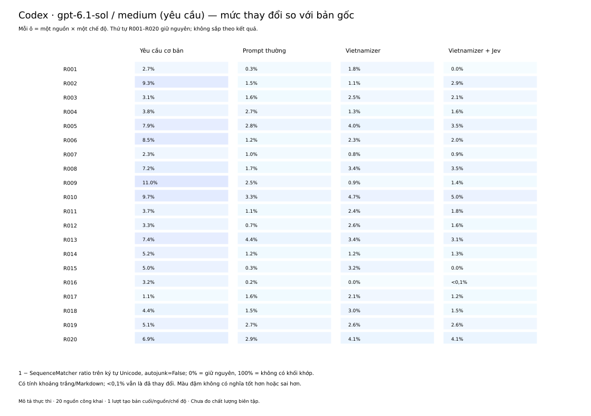
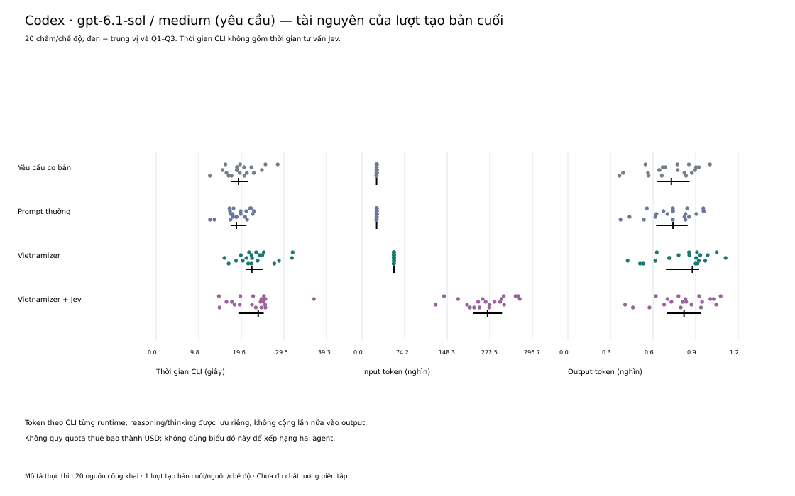
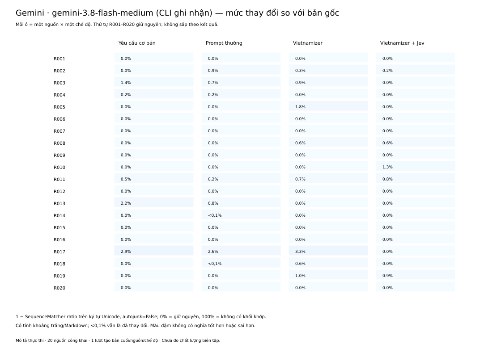
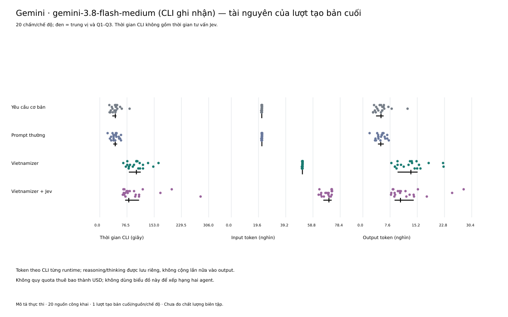
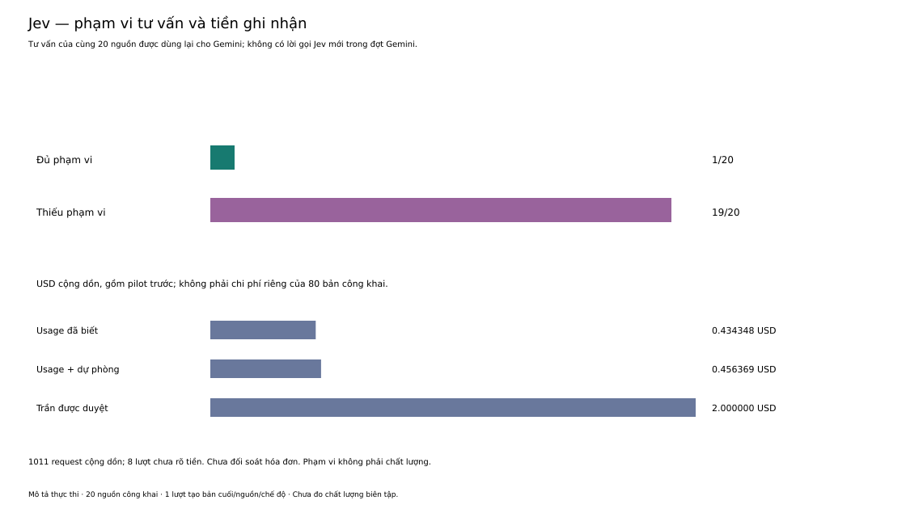

# Benchmark thực thi Vietnamizer: trước và sau trên cùng agent

**Ngày báo cáo: 26/10/2026 · Mô tả thực thi · Chưa đánh giá chất lượng biên tập.**

Báo cáo sử dụng 160 bản đã chạy, chia thành hai bộ độc lập theo runtime. Mỗi bộ gồm
20 nguồn và bốn chế độ trên cùng cấu hình agent/model. Mục tiêu sản phẩm là xác định
bản sau Vietnamizer có tốt hơn bản gốc hay không; các số liệu dưới đây mới mô tả mức
thay đổi và tài nguyên thực thi, chưa trả lời được câu hỏi chất lượng đó.

Fio quyết định tạm bỏ người chấm ở giai đoạn này. Không đọc phiếu khảo sát, không chạy
thêm benchmark hoặc model chấm, không gọi Jev và không sửa hai Forms trong lần lập
báo cáo. Điểm model từ pilot giả lập cũ không được dùng cho bộ nguồn công khai này.

## Material Passport

- Dữ liệu: public-ai-v1, 20 nguồn; Codex public-ai-benchmark-v2 và Gemini epoch-v3.
- Nguồn sơ cấp của phép đo: corpus/prompt đã đóng băng, raw CLI và kết quả từng cell;
  1.377 file đầu vào được ghi SHA-256 trong input-manifest.json của gói báo cáo.
- Phân tích: benchmarks/execution_report.py; không có chấm ngữ nghĩa tự động.
- Trạng thái xác minh: số đo tất định được tái lập từ raw; chất lượng chưa đánh giá.
- Không suy diễn xếp hạng Codex–Gemini, không gộp hai runtime thành một mẫu thống kê.

## Thiết kế và nguồn dữ liệu

20 câu trả lời assistant nguyên văn từ
[TTP01/Vietverse-SFT-Preview](https://huggingface.co/datasets/TTP01/Vietverse-SFT-Preview/tree/6b4e4a86e3b399318ac4fe91b2bbe64501037f40),
revision 6b4e4a86e3b399318ac4fe91b2bbe64501037f40. Nhà phát hành ghi synthetic_llm;
chưa có raw API hoặc model tạo nguồn được đối soát. Đã lưu 100 dòng gốc, metadata,
thẻ dữ liệu và quyết định tuyển/loại. Chọn 20 mẫu theo điều kiện đã chốt trước khi
biên tập, không chọn theo đầu ra. Đây là tập SFT đã tuyển chọn từ một nhà phát hành,
không phải mẫu web ngẫu nhiên hoặc holdout độc lập với dữ liệu huấn luyện model.

Giữ nguyên được kiểm trên nội dung text sau giải mã JSON; cùng code point có cùng byte UTF-8. Không so byte container JSON.

“Trước” là bản AI gốc; “sau” là đầu ra biên tập từ chính bản đó. Bốn chế độ là yêu cầu
biên tập cơ bản, prompt thường, Vietnamizer và Vietnamizer + Jev. Nhánh cơ bản vẫn là
bản đã biên tập, không thay thế bản gốc. Mỗi nguồn/chế độ có một lượt tạo bản cuối;
không lặp nhiều lần để đo biến thiên sinh văn bản.

Trong bộ Codex, cấu hình yêu cầu gpt-6.1-sol, effort medium; backend chưa có bằng
chứng độc lập. Trong bộ Gemini, raw CLI ghi nhận gemini-3.8-flash-medium và agent riêng
chỉ dùng finish. Mỗi bộ có 80 hội thoại riêng được đối chiếu với raw; không ghi nhận
tool thực thi trong các đầu ra được nhận. Hai lượt host Gemini cũ bị giữ ngoài bộ
80 bản này để chẩn đoán. Chúng không bị xóa hoặc lặng lẽ tính thành kết quả hợp lệ.

Tất cả prompt công khai của hai bộ được đối chiếu byte. Đây là kiểm sự nhất quán của
nội dung được giao; không chứng minh hai provider có cùng tokenizer, hidden context,
cache, độ trễ dịch vụ hoặc cách hạch toán token. Vì vậy không xếp hạng agent từ các số này.

## Phương pháp và cách đọc hình

- Mức thay đổi ký tự = 1 − SequenceMatcher.ratio(original, edited), autojunk=False,
  tính trên Unicode code point và giữ nguyên Markdown/khoảng trắng. Không phải
  Levenshtein, số lỗi, số edit ngữ nghĩa hoặc điểm chất lượng. Thuật toán lấy khối
  khớp với bản gốc luôn ở phía trái; không giả định đối xứng.
- Phân tích nhạy với định dạng: tính thêm cùng chỉ số sau khi gộp mỗi chuỗi khoảng
  trắng thành một dấu cách và bỏ khoảng trắng đầu/cuối. Không chuẩn hóa NFC/NFD,
  không bỏ Markdown, không coi đây là phần trăm nội dung hoặc ý nghĩa đã đổi.
- Độ dài = số Unicode code point. Thay đổi độ dài (%) = 100 × (sau/trước − 1).
  Độ dài không phải số từ tiếng Việt và không đo độ dễ đọc.
- Mỗi chấm là một nguồn; giữ toàn bộ 20 nguồn trong mỗi chế độ, không cắt ngoại lệ.
  Vạch đen là trung vị, đoạn đen là Q1–Q3, nội suy tuyến tính trên thứ tự số liệu.
  Q1–Q3 mô tả phân bố, không phải CI hoặc sai số ước lượng.
- Thời gian là lượt CLI tạo bản cuối, gồm overhead của từng wrapper; không gồm thời
  gian tuyển nguồn, tư vấn Jev, phục hồi hoặc thao tác người dùng. Không phải tổng
  latency đầu-cuối của workflow có Jev.
- Token là bộ đếm CLI. Input/output/reasoning hoặc thinking giữ riêng; không cộng
  reasoning vào output để dựng một tổng token mới. Không suy USD từ quota thuê bao.

Đơn vị nguồn độc lập là 20, không phải 80 bản hay 160 đầu ra. Đây là mô tả toàn bộ
cohort cố định; báo cáo không kiểm định giả thuyết, p-value, CI quần thể hoặc kết luận
nhân quả. Bảng và heatmap giữ ID nguồn để kiểm các ca riêng thay vì che chúng bằng
một số trung bình. Nhiều chấm có thể trùng tọa độ; CSV giữ đủ từng cell.


## Kết quả trong bộ Codex

Mỗi chế độ hoàn tất **20/20** bản; n = 20 nguồn/chế độ.

| Chế độ | Giữ nguyên byte | Giữ nguyên sau gộp khoảng trắng | Thay đổi ký tự, trung vị [Q1; Q3] | Độ dài, trung vị [Q1; Q3] |
|---|---:|---:|---:|---:|
| Yêu cầu cơ bản | 0/20 | 0/20 | 5.06 [3.26; 7.52]% | 2.14 [0.63; 3.74]% |
| Prompt thường | 0/20 | 0/20 | 1.55 [1.09; 2.67]% | 1.10 [0.51; 1.86]% |
| Vietnamizer | 1/20 | 1/20 | 2.42 [1.25; 3.27]% | 0.70 [-0.01; 1.68]% |
| Vietnamizer + Jev | 2/20 | 3/20 | 1.75 [1.31; 2.97]% | 0.87 [0.15; 1.96]% |

Giữ nguyên có thể là lựa chọn biên tập hợp lệ; thay đổi nhiều cũng có thể chứa sửa sai. Không phân loại hai trường hợp này khi chưa chấm chất lượng.




| Chế độ | CLI giây, trung vị [Q1; Q3] | Input token, trung vị [Q1; Q3] | Output token, trung vị [Q1; Q3] |
|---|---:|---:|---:|
| Yêu cầu cơ bản | 18.98 [17.21; 21.16] | 25409.00 [25258.25; 25650.25] | 727.00 [623.25; 855.25] |
| Prompt thường | 18.49 [17.16; 20.83] | 25445.00 [25328.25; 25574.25] | 738.50 [620.25; 841.25] |
| Vietnamizer | 22.04 [20.61; 24.56] | 55595.00 [55466.25; 55672.00] | 875.00 [688.75; 922.50] |
| Vietnamizer + Jev | 23.52 [18.95; 24.79] | 218599.00 [193384.50; 243833.25] | 816.00 [694.00; 937.00] |




## Kết quả trong bộ Gemini

Mỗi chế độ hoàn tất **20/20** bản; n = 20 nguồn/chế độ.

| Chế độ | Giữ nguyên byte | Giữ nguyên sau gộp khoảng trắng | Thay đổi ký tự, trung vị [Q1; Q3] | Độ dài, trung vị [Q1; Q3] |
|---|---:|---:|---:|---:|
| Yêu cầu cơ bản | 15/20 | 15/20 | 0.00 [0.00; 0.06]% | 0.00 [0.00; 0.00]% |
| Prompt thường | 12/20 | 12/20 | 0.00 [0.00; 0.16]% | 0.00 [0.00; 0.05]% |
| Vietnamizer | 12/20 | 12/20 | 0.00 [0.00; 0.66]% | 0.00 [0.00; 0.00]% |
| Vietnamizer + Jev | 15/20 | 15/20 | 0.00 [0.00; 0.04]% | 0.00 [0.00; 0.00]% |

Giữ nguyên có thể là lựa chọn biên tập hợp lệ; thay đổi nhiều cũng có thể chứa sửa sai. Không phân loại hai trường hợp này khi chưa chấm chất lượng.




| Chế độ | CLI giây, trung vị [Q1; Q3] | Input token, trung vị [Q1; Q3] | Output token, trung vị [Q1; Q3] |
|---|---:|---:|---:|
| Yêu cầu cơ bản | 43.73 [35.23; 46.64] | 21940.00 [21842.25; 22080.25] | 5077.50 [3690.00; 5805.75] |
| Prompt thường | 43.36 [37.74; 48.82] | 22007.00 [21907.00; 22144.50] | 5005.50 [4218.75; 5858.00] |
| Vietnamizer | 102.89 [81.76; 115.22] | 51178.00 [51076.75; 51315.75] | 13431.50 [9707.00; 15309.25] |
| Vietnamizer + Jev | 81.51 [71.19; 110.37] | 70288.50 [66256.25; 72262.50] | 10518.50 [8862.75; 14228.75] |




## Jev: phạm vi và tiền ghi nhận

Chỉ **1/20 nguồn** đủ phạm vi theo hợp đồng; 19 nguồn có phần chưa kiểm, ngữ cảnh hoặc
phân đoạn chưa đủ, hay lỗi dịch vụ/phân phối. Các ca này vẫn ở bộ 20 nguồn, không loại
để làm đẹp kết quả. Nhánh có Jev đo workflow dùng tư vấn với giới hạn đã xảy ra, không
phải điều kiện Jev luôn có đủ phản hồi. Advice đã xác thực của bộ Codex được dùng lại
cho Gemini; không có chi phí Jev mới trong đợt Gemini.

| Phạm vi | Request | Usage USD đã biết | Usage + dự phòng USD |
|---|---:|---:|---:|
| Pilot trước | 435 | 0,192088554 | 0,200346090 |
| Đợt nguồn công khai | 576 | 0,242259906 | 0,256022466 |
| Cộng dồn | 1.011 | 0,434348460 | 0,456368556 |

Có 8 request cộng dồn chưa rõ tiền, giữ dự phòng; trần duyệt là 2 USD. Đây là số tính
từ usage và dự phòng đã lưu, **chưa đối soát hóa đơn**. Không gán toàn bộ chi phí cộng
dồn cho riêng 80 bản công khai, không tính advice dùng lại thành một đợt chi phí mới.



## Những kết luận được và chưa được hỗ trợ

Dữ liệu hỗ trợ việc mô tả 80/80 bản hợp lệ trong từng bộ, mức thay đổi của từng nguồn,
phân bố độ dài, thời gian CLI và token. Các hình giúp tìm ca cần đọc kỹ, chẳng hạn bản
giữ nguyên hoặc mức thay đổi lớn; chúng chưa quyết định ca đó tốt hay sai.

Dữ liệu hiện tại **không đủ kết luận Vietnamizer làm văn bản hay hơn, giữ nghĩa tốt
hơn hoặc Jev tạo lợi ích chất lượng tăng thêm**. Không có nhãn độc lập về đúng/sai,
giữ giọng, độ dễ đọc hoặc sửa quá tay trên bộ công khai. Không dùng điểm Jev, độ ngắn,
độ khác ký tự hoặc tỷ lệ giữ nguyên thay cho những nhãn này. Báo cáo này cũng không
kết luận agent nào dùng skill tốt hơn agent nào.

## Lưu trữ và tái lập

Gói local `artifacts/014-execution-report-20261026-v4` chứa cells.csv (160 hàng),
summary.csv/JSON (8 nhóm), input-manifest.json, receipt, code snapshot và toàn bộ hình
SVG/PDF/PNG 300 DPI. File cells.csv giữ nguồn, chế độ, hash bản gốc/bản sửa, số đo,
usage và thời gian. Gói còn có thư mục reproduce chứa bản sao đúng hash của toàn bộ 1.377 đầu vào và ba module Python để chạy độc lập với checkout ban đầu. Raw gốc vẫn giữ trong hai epoch đã đóng băng, không sao chép khóa API,
không đọc hoặc chuyển dữ liệu người chấm. Raw được đối soát gồm CLI stdout/stderr,
wrapper envelope, native event, prompt và seal; không có native HTTP body của provider
vì CLI không cung cấp. SHA-256 phát hiện thay đổi, không phải chữ ký chống giả mạo.

Từ repo, dùng Python có ReportLab đã cài và một thư mục đầu ra mới:

```bash
python3 -B -m benchmarks.execution_report --output artifacts/014-execution-report-REPRO --charts
node benchmarks/render_quality_charts.mjs artifacts/014-execution-report-REPRO/charts EXISTING_NODE_RUNTIME_ROOT
```

Sau khi giải nén gói bàn giao, có thể chạy ngay trong thư mục reproduce:

```bash
python3 -B -m benchmarks.execution_report --output ../NEW_RESULTS
```

Bỏ --charts thì chỉ cần Python standard library. Lệnh chỉ đọc artifact và ghi thư mục
mới; không gọi provider, Jev hay Forms. CSV/summary phải khớp tuyệt đối khi cùng input
và code. Hình giữ số liệu như nhau nhưng byte PDF có thể đổi theo metadata thời gian
hoặc phiên bản renderer/font; gói giao có manifest riêng. Nguồn code, runtime dựng
hình và hash font được giữ trong gói để tái lập.

## Rà giới hạn thống kê: 11/11 mục

| Mục kiểm | Áp dụng và giới hạn |
|---|---|
| Simpson | Báo từng nguồn/chế độ/runtime, không chỉ tổng gộp; không suy xu hướng giữa nhóm |
| Sinh thái | Không suy hành vi người đọc hay mọi văn bản từ cohort nguồn này |
| Berkson/tuyển mẫu | Có: một tập SFT tuyển chọn, không ước lượng tương quan quần thể |
| Collider | Không hồi quy hoặc điều kiện hóa theo kết quả; không loại ca Jev lỗi |
| Bỏ qua tỷ lệ nền | Không báo sensitivity/precision; tỷ lệ giữ nguyên có mẫu số 20 rõ ràng |
| Hồi quy về trung bình | Không chọn mẫu theo điểm cực đoan và không gọi mức thay đổi là cải thiện |
| Sống sót | Giữ 80/80 cell hiện hành mỗi runtime; các lượt chẩn đoán cũ được nêu riêng |
| Nhiều phép thử | Không p-value hoặc lựa chọn “thắng”; công bố cả bốn chế độ và mọi nguồn |
| Nhiều đường phân tích | Báo cáo mô tả sau khi tạo dữ liệu; không tuyên bố đăng ký trước hoặc xác nhận |
| Tương quan–nhân quả | Không dùng số đo ký tự/tài nguyên để kết luận tác động chất lượng |
| Nhân quả ngược | Không dựng mô hình quan hệ nhân quả; số liệu chỉ mô tả đầu ra và thực thi |

Các kiểm tra trên giới hạn cách diễn giải, không biến cohort thành một thí nghiệm
chất lượng đã nghiệm thu. Hai Forms và kế hoạch chấm cũ vẫn lưu để dùng lại nếu Fio
quyết định tiếp tục; chưa phải yêu cầu phải chờ khảo sát để phát hành báo cáo mô tả này.
