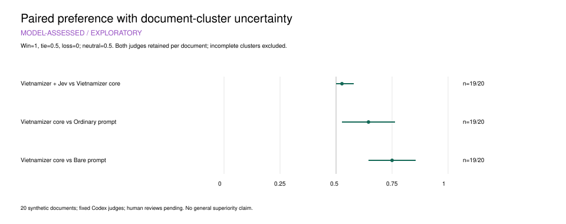
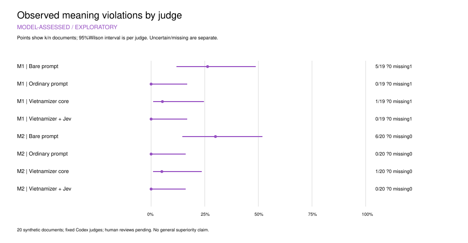
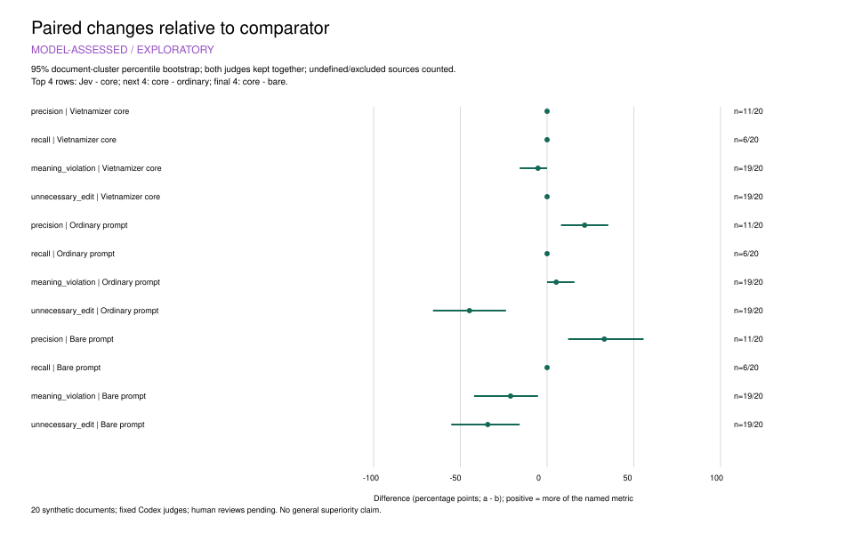
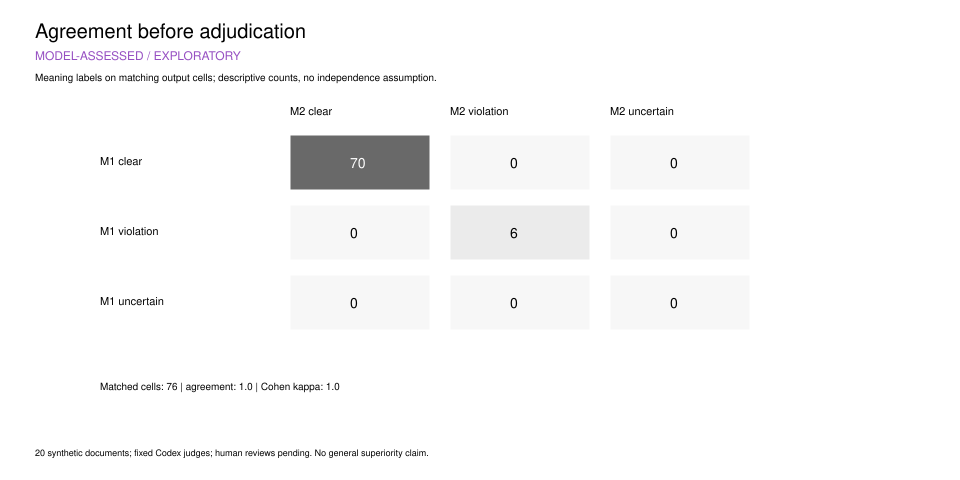

# Chấm chất lượng bằng model — pilot ngày 25/10/2026

**MODEL-ASSESSED / EXPLORATORY.** Đây là kết quả thăm dò trên 20 văn bản giả lập,
không phải nhãn chuẩn của người đọc hoặc kiểm chứng trên holdout. Chưa nhận bài chấm thật.

## Phạm vi đã chạy

- 80 bản cuối, bốn chế độ; dùng đúng nguồn/bản đã đóng băng của đợt phục hồi.
- Hai cấu hình giám khảo yêu cầu qua Codex CLI: GPT-6.1 Sol và GPT-6 Astra, medium;
  hai inventory chỉ đọc nguồn trước, rồi phiên mới cho từng nhóm bốn bản.
- 42 starts: hai inventory hợp lệ, 39 nhóm hợp lệ, một nhóm lỗi giao thức. Có **156/160**
  nhận xét đầu ra hợp lệ; bốn nhận xét thiếu thuộc cùng một nhóm của giám khảo M1.
- Model trả `damaged` ngoài danh sách enum ở nhóm smoke đầu tiên. Raw được giữ, không
  đổi nhãn hoặc gọi lại nhóm đó. Bản bổ sung chỉ làm rõ cách viết enum cho các lượt sau;
  inventory hợp lệ được kế thừa bằng đối soát prompt/raw/key. Xem [bản bổ sung](quality-enum-amendment.md).
- Raw của cả 42 lượt có usage: 1.064.620 input tokens, 32.587 output tokens, trong đó
  runtime báo 4.244 reasoning output tokens. Tổng thời gian các lượt gọi 1.128,32 giây;
  đây không phải tổng thời gian nghiên cứu. Dùng quota subscription, không gọi API trả tiền.
- Không có tool event thực trong phản hồi đã kiểm. Requested model được ghi; backend
  không cung cấp attestation, nên chưa xác nhận độc lập model thực phục vụ từng yêu cầu.

Hai cấu hình cùng nhà cung cấp, một cấu hình trùng họ model sinh bản; phiên riêng không
bảo đảm hai giám khảo độc lập về thiên lệch. Chấm cả bốn bản trong cùng nhóm cũng có thể
chịu ảnh hưởng tương phản. Key đổi riêng theo giám khảo/nguồn và cân bằng vị trí.

## Lựa chọn bản cuối

Mỗi hàng có 40 phiếu dự kiến từ 20 nguồn × hai giám khảo; các phiếu trong cùng nguồn
không độc lập. Đây là so sánh suy ra từ xếp hạng chung, cho phép đồng hạng.

| Bên được xét so với đối chứng | Thắng | Hòa | Thua | Thiếu | Preference ghép cặp, CI 95% |
|---|---:|---:|---:|---:|---|
| Vietnamizer + Jev so với Vietnamizer tự rà | 2 | 37 | 0 | 1 | 0,526 [0,500; 0,579] |
| Vietnamizer tự rà so với prompt thường | 15 | 21 | 3 | 1 | 0,645 [0,526; 0,763] |
| Vietnamizer tự rà so với không skill | 20 | 19 | 0 | 1 | 0,750 [0,645; 0,855] |

Preference mã hóa thắng=1, hòa=0,5, thua=0; trung tính=0,5. CI dùng paired bootstrap
10.000 lần theo văn bản, seed 25055, giữ cả hai giám khảo trong cluster. Chỉ 19/20 nguồn
đủ hai lượt cho CI; phiếu đơn của nguồn còn lại vẫn xuất hiện trong bảng đếm. CI chỉ mô tả
biến thiên có điều kiện trên corpus và giám khảo này, không xác nhận đại diện cho tiếng Việt.

**Chưa có bằng chứng rõ về lợi ích tăng thêm của Jev:** đa số hòa, CI preference còn chạm
mức trung tính. So sánh Vietnamizer tự rà với hai baseline có thêm lượt sửa và tái sử dụng
baseline cũ; không được quy toàn bộ khác biệt cho skill. Không lấy số “thắng + hòa” làm
một tỷ lệ thành công hoặc tuyên bố cải thiện phần trăm.




## Giữ nghĩa và các tiêu chí khác

| Chế độ | M1: ca bị gắn nhãn đổi nghĩa / ca chấm được | M2: ca bị gắn nhãn đổi nghĩa / ca chấm được |
|---|---:|---:|
| Không skill | 5/19 | 6/20 |
| Prompt thường | 0/19 | 0/20 |
| Vietnamizer tự rà | 1/19 | 1/20 |
| Vietnamizer + Jev | 0/19 | 0/20 |

Đây là nhãn model, chưa được người đọc xác nhận. Không thấy lỗi không chứng minh rủi ro
bằng 0: Wilson 95% cho 0/19 có cận trên 16,8%; với 0/20 là 16,1%. Không gộp hai giám khảo
thành 39 hoặc 40 mẫu độc lập. Vi phạm nghĩa không bị bù bằng độ trôi chảy hoặc preference.



Precision tính theo diff block; recall dựa trên issue nguồn của chính giám khảo, đã khóa
trước khi xem output. Nguồn không có issue hoặc bản không có edit có mẫu số 0 → N/A.
Trong phép so sánh Jev với tự rà, precision chỉ có 11 nguồn đủ mẫu số ở cả hai giám khảo,
recall chỉ có sáu; chênh lệch quan sát đều bằng 0. Interval bootstrap co về 0 trong tập con
này không chứng minh tương đương hoặc không có rủi ro. Bảng dữ liệu giữ số loại/mẫu thiếu.



Trên 76 cặp output đủ cả hai model, agreement cho nghĩa và giọng là 100%, kappa=1;
vùng bảo toàn cũng agreement 100% nhưng kappa không xác định vì mọi nhãn đều clear.
Đó là mô tả nhãn, không chứng minh độ đúng hoặc sự độc lập của hai model. Backend chưa
được attestation và hai cấu hình cùng nhà cung cấp là những giới hạn đặc biệt đáng chú ý.



## Dữ liệu, chạy lại và phần còn chờ

Epoch canonical: `artifacts/014-quality-assessment-20261025-v3`. Manifest gốc/bổ sung,
packet/key, prompt/schema, stdout/stderr, response chưa kiểm, labels, usage và lỗi giữ local.
`analysis/` chứa summary JSON, CSV theo output/metric, numerator/denominator, missingness,
CI và source figure. Có SVG/PDF vector cùng PNG 300 DPI; `render-manifest.json` ghi renderer,
phiên bản và kích thước. [Protocol](quality-protocol.md) và [hướng dẫn giao người chấm](human-handoff.md)
xác định phần chấm người và đối soát còn mở.

Tính lại bằng chứng tại checkout có raw canonical, không gọi model:

```bash
python3 -m benchmarks.quality_analysis --output artifacts/014-quality-assessment-20261025-v3
```

Vẽ lại từ summary đã lưu không cần API hoặc các đường dẫn raw cũ; dùng ReportLab đã có sẵn
và `--charts-only`. PNG dùng `render_quality_charts.mjs` với một runtime đã có Sharp.
Không tự cài dependency. Replay raw đầy đủ hiện ràng buộc đường dẫn tuyệt đối trong manifest;
khi chuyển máy cần ánh xạ đường dẫn và kiểm lại digest, không sửa raw hoặc nhận manifest
đã đổi như bằng chứng cũ. Các bảng/figure được lưu cùng archive để dựng lại độc lập với quota.

Đã chạy 46 test mục tiêu cho quality, import/analysis và runner Codex được dùng lại; không
chạy full suite. Đã kiểm UI bằng một nhóm thao tác trực tiếp và fixture giả lập cho các nhóm
còn lại; dữ liệu QA bị chặn khỏi human ingestion. Chưa có hai người chấm thật, đối soát,
Form chấm bản sửa/chuyển nhãn thật trên cloud, holdout hoặc kết luận hơn đối chứng
trên văn bản mới. Hai form chỉ đọc nguồn đã được tạo và kiểm UI sau lượt chấm model;
xem trạng thái hiện hành trong hướng dẫn giao người chấm.
