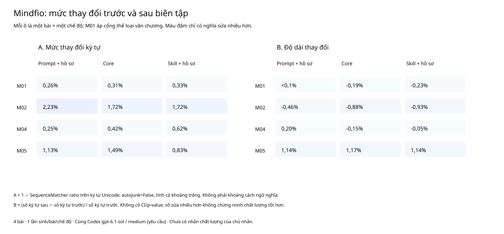
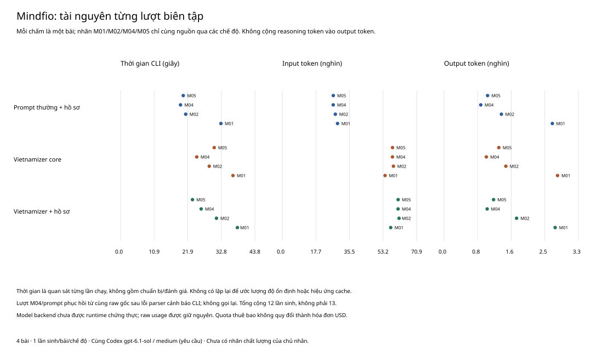

# Mindfio: trước và sau khi biên tập trên cùng agent

**Ngày 27/10/2026 · 12/12 đầu ra · source Vietnamizer 0.12.0 · Phân tích thăm dò.**

Vietnamizer sửa được những chỗ cụ thể trong bộ này, nhưng thêm hồ sơ chưa cho thấy
lợi ích đồng đều trên cả bốn bài. Có trường hợp giữ được nhịp ngắn của bản gốc tốt
hơn bản core; cũng có chỗ thay dấu hoặc chọn cách diễn đạt cần chủ nhân xem lại.
Đây là nhận xét của agent thực hiện nghiên cứu, không phải nhãn chất lượng độc lập
hoặc kết luận thống kê rằng skill thắng đối chứng.

## Thiết kế và những gì đã chạy

Chủ nhân duyệt bản mô tả giọng được rút riêng từ bốn bài tham chiếu, rồi chốt chạy
pilot. Bốn bài còn lại nhận ba cách biên tập, luôn bắt đầu từ cùng bản đã đăng:

| Chế độ | Thông tin được nhận |
| --- | --- |
| Prompt thường + hồ sơ | Chỉ dẫn biên tập thông thường và cùng hồ sơ đã duyệt |
| Vietnamizer core | Quy tắc 0.12.0; giữ giọng từ bản gốc, không nhận hồ sơ |
| Vietnamizer + hồ sơ | Cùng quy tắc, hồ sơ đã duyệt và hướng dẫn đọc mẫu được nạp theo điều kiện |

Codex CLI **0.164.0**, yêu cầu **gpt-6.1-sol / medium**, qua thuê bao ChatGPT.
Mỗi ô là một phiên ephemeral mới: **12 ID phiên khác nhau, không có tool call thực
tế** trong raw. Backend model không được runtime chứng thực. Không có Jev hoặc
giám khảo API mới; quota thuê bao không được quy thành hóa đơn USD.

Nguồn giữ XML RSS, HTML từng bài, bản chữ, URL và hash. Bốn trang công khai đều
trả HTTP 200; tìm thấy lần lượt **47/47, 40/40, 32/32 và 46/46** đoạn nội dung RSS
sau khi gộp khoảng trắng. Đây là đối chiếu sự tương ứng văn bản, không xác minh các
khẳng định khoa học, câu chuyện hay tài liệu tham khảo trong bài. Nguồn đã qua AI
theo xác nhận của chủ nhân; không có bản nháp trước AI hoặc log sinh gốc.

M01 được xác định trước lúc sinh là lời tựa có nhịp và hình ảnh văn chương; cả ba
prompt nhận cùng ghi chú chỉ sửa typography. Ba bài còn lại là blog suy ngẫm cá nhân.
Người rút hồ sơ không đọc bốn bài dành đánh giá. Ba phần AI-First trong nhóm tham
chiếu thuộc một chuỗi, không tính thành ba nguồn độc lập. Bộ này gồm một publication
và cách chọn có chủ đích, không đại diện cho mọi tác giả hoặc thể loại tiếng Việt.

## Thay đổi và tài nguyên

Mức thay đổi là **1 − SequenceMatcher ratio** trên ký tự Unicode, `autojunk=False`,
luôn đặt bản gốc trước, tính cả khoảng trắng. Nó không phải khoảng cách ngữ nghĩa
hoặc tỷ lệ sửa đúng. Tất cả 12 bản khác bản chữ gốc ở mức byte/ký tự; không dùng
điều đó làm bằng chứng chất lượng. Độ dài bản gốc gồm ký tự xuống dòng cuối.

| Bài | Prompt + hồ sơ | Core | Vietnamizer + hồ sơ |
| --- | ---: | ---: | ---: |
| [M01 — lời tựa 22 tiểu luận](https://mindfio.substack.com/p/22-tieu-luan-con-nguoi-ai-va-khu-rung-den-toi-loi-tua-) | 0,262% | 0,313% | 0,332% |
| [M02 — ba điều buông/giữ](https://mindfio.substack.com/p/3-dieu-minh-buong-3-dieu-minh-giu-lai) | 2,232% | 1,724% | 1,725% |
| [M04 — quẻ bói](https://mindfio.substack.com/p/co-the-ban-ang-song-theo-mot-que) | 0,249% | 0,424% | 0,623% |
| [M05 — tập trung](https://mindfio.substack.com/p/tap-trung-that-hay-gia-vo-tap-trung) | 1,130% | 1,488% | 0,829% |

| Trung vị trên bốn bài | Prompt + hồ sơ | Core | Vietnamizer + hồ sơ |
| --- | ---: | ---: | ---: |
| Mức thay đổi ký tự | 0,696% | 0,956% | 0,726% |
| Độ dài thay đổi | +0,106% | −0,171% | −0,140% |
| Thời gian CLI | 20,83 giây | 29,72 giây | 28,77 giây |
| Input token | 27.443,5 | 58.150,5 | 61.114,5 |
| Output token | 1.239,5 | 1.432 | 1.499 |

Chỉ có một lần sinh cho mỗi ô; không có CI, p-value hoặc kiểm tra độ ổn định qua
lặp lại. Không coi 12 đầu ra là 12 bài độc lập. Input token cao hơn ở hai nhánh
skill phản ánh lượng chỉ dẫn gửi vào; thời gian còn chịu ảnh hưởng lần chạy và
cache, không được diễn giải thành tốc độ cố định của sản phẩm. Không cộng riêng
reasoning token vào output token; giữ nguyên mọi trường usage trong raw.

## Rà nội dung từng bài

Các nhận xét sau là **HOST-ASSESSED / EXPLORATORY**, không chấm ẩn nhãn. Có thể đối
chiếu toàn bộ thay đổi trong `before-after.html`, các file `.diff` và bản cuối nguyên
trạng. Không sửa tay hoặc chọn lại đầu ra để làm đẹp kết quả.

| Bài | Prompt thường + hồ sơ | Vietnamizer core | Vietnamizer + hồ sơ |
| --- | --- | --- | --- |
| M01 | Thêm `đi` vào `nhân tính sẽ ngày càng mất`, sửa lời mời cuối bài; vượt giới hạn chỉ sửa typography đã giao | Giữ từ ngữ thân bài trong phạm vi dấu/viết hoa; đổi gạch chú thích sang ngoặc, dấu phẩy hoặc hai chấm | Tương tự core về phạm vi; giữ hình ảnh và lập luận, nhưng khác một số lựa chọn dấu và cách trình bày `Niết Bàn` |
| M02 | Bỏ từ `mình` gõ lặp; đổi `kết quả... (output)` thành `công việc... (output)` | Bỏ từ lặp; giữ cách gọi `kết quả... (output)`; có diễn đạt lại tiêu đề | Bỏ từ lặp, tách câu outcome/output; giữ cách gọi `kết quả`; đổi hình thức ngoặc kép của `wake-up call` |
| M04 | Chọn `gieo quẻ` thay `xủ quẻ`, thêm `ta` trong một câu lược chủ thể | Cũng chọn `gieo quẻ`, chủ yếu sửa dấu ở phần lập luận | Giữ `xủ quẻ`, thêm `kết quả` vào `khi không như ý`, sửa dấu và cách viết `thành bại`; chưa đủ bằng chứng gọi nhánh này tốt hơn |
| M05 | Hoàn chỉnh cụm `thông minh và kiểm soát hơn`; giữ câu ngắn `Mà chạy để tránh đối diện.` | Hoàn chỉnh cụm trên; mở rộng câu ngắn thành `Mà chạy để tránh đối diện với sự trống rỗng ấy.` | Hoàn chỉnh cụm trên nhưng giữ câu ngắn và nhiều dấu tạo nhịp; mức sửa ký tự thấp hơn core ở riêng bài này |

Ba quan sát có ích cho việc sử dụng:

1. **Sửa lỗi cụ thể vẫn cần đối chứng.** M02 `Điều mình mình thật sự hướng đến`
   được cả ba nhánh sửa thành `Điều mình thật sự hướng đến`. Đây là cải thiện rõ về
   lỗi gõ lặp, nhưng không phải lợi ích riêng của Vietnamizer hoặc hồ sơ.
2. **Có trường hợp nhánh kèm hồ sơ giữ nét đã có.** M05, nhánh có hồ sơ giữ nguyên câu ngắn
   `Mà chạy để tránh đối diện.` Trong bản core, phần thêm chỉ tới `sự trống rỗng`,
   trong khi đoạn trước nêu cả sợ bỏ lỡ, sợ bị đánh giá và sợ khoảng trống. Đây là
   chỗ cần cân nhắc nguy cơ thu hẹp ý và mất nhịp; chưa có nhãn chủ nhân để kết luận
   cách nào đúng ý hơn. Prompt thường cũng giữ câu này, nên không thể quy lợi ích
   riêng cho hướng dẫn đọc mẫu mới. So sánh core với nhánh có hồ sơ thay đổi cả hồ sơ
   lẫn guide được nạp theo điều kiện; thiết kế này chưa tách riêng tác động hai phần.
3. **Ít sửa không đồng nghĩa sửa đủ hoặc giữ giọng tốt hơn.** M04 có khác biệt ở
   `xủ quẻ`/`gieo quẻ`; nghiên cứu này không dùng khác biệt đó làm nhãn lỗi tiếng
   Việt vì chưa có đối chứng ngôn ngữ hoặc xác nhận của tác giả. M02, cả ba nhánh
   diễn đạt lại `kỳ vọng cái gì cũng muốn làm` theo hướng khả năng `làm được` hoặc
   `có thể làm`; cần chủ nhân xác nhận sắc thái muốn làm và kỳ vọng khả năng.

Kiểm chuỗi tất định không thấy mất chuỗi bảo toàn đã liệt kê trong prompt, URL và
phần tài liệu tham khảo; chuỗi số dạng chữ số có cùng thứ tự trong cả 12 bản.
Những kiểm tra này không xác nhận giữ nghĩa, không bao phủ số viết bằng chữ hoặc
tính đúng của tài liệu tham khảo. Bộ liệt kê quote lúc đóng băng chỉ lấy ngoặc kép
cong. Rà bổ sung sau khi bắt đầu sinh phát hiện một thay đổi: M02/có hồ sơ đổi
`"wake-up call"` thành `“wake-up call”`, vẫn giữ nguyên chữ bên trong; đoạn hội thoại
ngoặc thẳng còn lại được giữ. Đây là tín hiệu thay dấu, không tự động là lỗi nghĩa.
Cần phân biệt nhãn thuật ngữ có thể thống nhất theo T3 với trích dẫn nguyên văn phải
giữ byte; không tuyên bố kiểm chuỗi là đã kiểm hết vùng bảo toàn.

## Cải tiến học từ cộng đồng đã triển khai

Source 0.12.0 đã có phương pháp trong
[`references/giu-giong-tu-mau.md`](../../references/giu-giong-tu-mau.md), được gọi
theo điều kiện từ root skill và resolver. Đây là phần triển khai đã tồn tại trước
pilot; không dùng kết quả vừa thấy để âm thầm thay source giữa các nhánh.

| Phương pháp học được | Cách đã đưa vào Vietnamizer |
| --- | --- |
| write-like-me: thói quen và nét thỉnh thoảng | Đặc tính cần phạm vi/ví dụ; không rải câu cửa miệng, không dùng quota |
| Synthesis Voice Profiler: mô tả cụ thể để người dùng xem | Rút xưng hô, từ vựng, nhịp, lập luận, mở/kết bằng trích đoạn có căn cứ |
| Voice Builder: điều cấm khác với chưa quan sát | Không suy từ vài mẫu rằng người dùng không bao giờ dùng một cấu trúc |
| MyDamnVoice: giọng theo hoàn cảnh | Giữ phạm vi kênh/mục đích trong resolver hiện hành; không trộn thành giọng trung bình |

Xem [nguồn và revision đã kiểm](research.md). Hướng dẫn/ví dụ tiếng Việt được viết
riêng; không cài workflow bên ngoài, không mang hồ sơ Mindfio vào quy tắc chung.
Đã chạy lại sáu test package consumer và chín test harness; validator/registry đạt.
Ba archive local đều có đúng một `SKILL.md` và guide mới đúng byte, không đóng gói
benchmark hoặc hồ sơ riêng. **Đã triển khai và đóng gói local, chưa cài runtime hoặc
phát hành.** VG01–VG08 vẫn là ca kỳ vọng rà tĩnh; pilot này không biến chúng thành
tám ca đã chạy đạt. Không có cơ sở thêm pattern ngôn ngữ từ bốn bài của một người.

## Raw, lỗi và tái lập

Kết quả hiện hành: `artifacts/017-mindfio-run-20261027-v2/`. Lưu full stdin,
stdout JSONL, stderr theo byte, argv, thời gian, session ID, usage, cấu hình yêu cầu,
prompt/source/profile snapshot và hash. Đây là **raw CLI**, không phải HTTP body
giữa CLI và nhà cung cấp; không có claim thu được raw HTTP đó.

Epoch v1 giữ nguyên lỗi parser: cảnh báo CLI về
`skip_host_skill_discovery` được phân loại nhầm là tool. Có final JSON hợp lệ,
`turn.completed`, exit0 và không tool. Sau regression test đỏ rồi xanh, chỉ nhận
lại **cùng raw** của ô M04/prompt thường. Epoch v2 có 12 prompt byte-identical,
giữ link/hash v1 và chạy tiếp 11 ô. Tổng số lượt sinh thật là **1 + 11 = 12**,
không phải 13, không chọn lại một bản sửa theo chất lượng. Cảnh báo được nhận bằng
mẫu hẹp đúng thông điệp đã quan sát; lỗi khác và tool call vẫn bị chặn.

Để tái lập phân tích từ bản lưu, dùng `python3 -B -m benchmarks.mindfio_pilot report
--output <thư-mục-v2>`; không gọi model. Trong gói có bản source runner để chạy
offline độc lập. Tái sinh đầu ra không được coi là tái lập tất định và không nằm
trong lệnh phân tích. CSV/JSON giữ đủ 12 ô; hai hình có SVG/PDF và PNG 300 DPI.

Các bộ benchmark lịch sử và gói chuẩn bị có đối soát SHA256 riêng; hai Forms không
được mở hoặc sửa trong đợt này. Không dùng hay nhập nhãn người chấm. Các giới hạn
và bằng chứng bảo toàn nằm trong biên nhận cuối của gói lưu trữ.

## Kết luận có thể dùng

Bộ nhỏ này xác nhận workflow có hồ sơ đã được thực thi và tạo ra các bản sửa có thể
đối chiếu. Có ví dụ sửa đúng lỗi gõ lặp và giữ được nét tạo nhịp, nhưng đối chứng
thường cũng làm được một số việc đó. Chưa chứng minh Vietnamizer kèm hồ sơ cải thiện
đều về chất lượng hoặc đúng giọng chủ nhân hơn. Dùng tính năng như một hỗ trợ biên
tập có nguồn tham chiếu và rà lại từng sửa đổi; không công bố tỷ lệ khớp giọng hoặc
tỷ lệ thắng từ bộ này.
